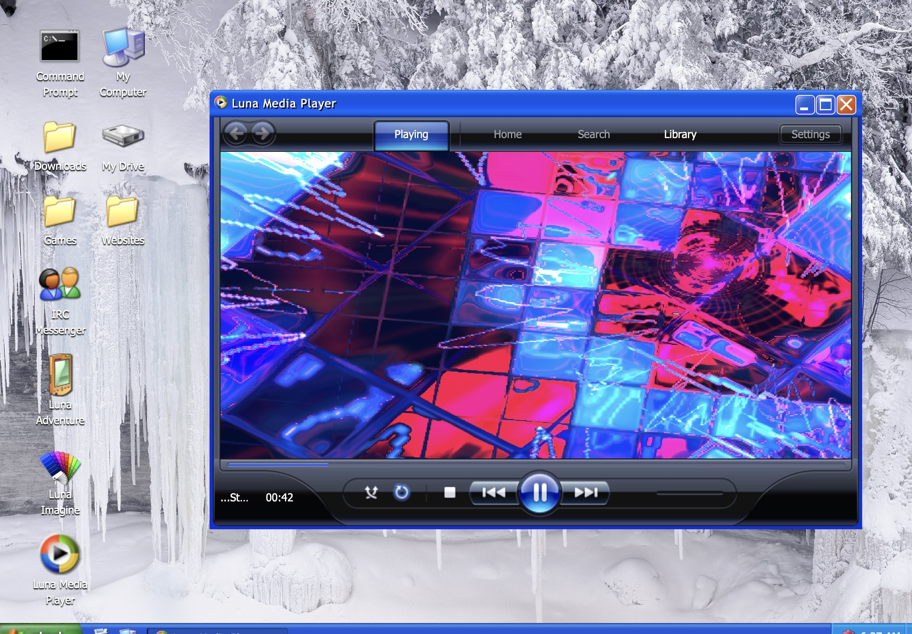
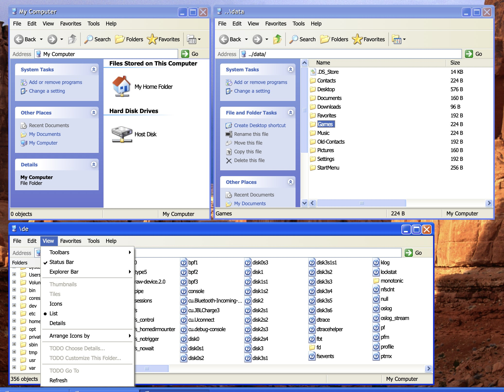
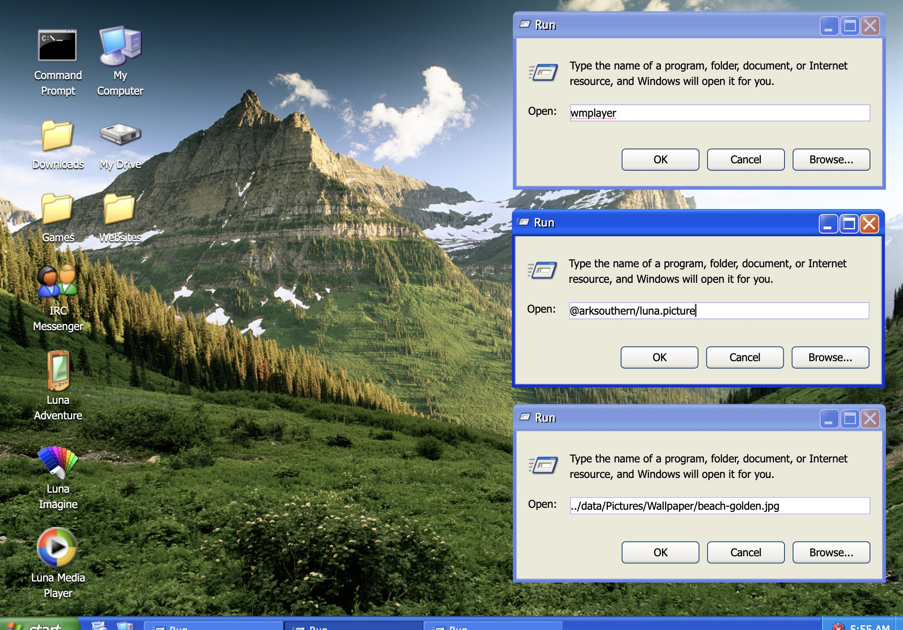
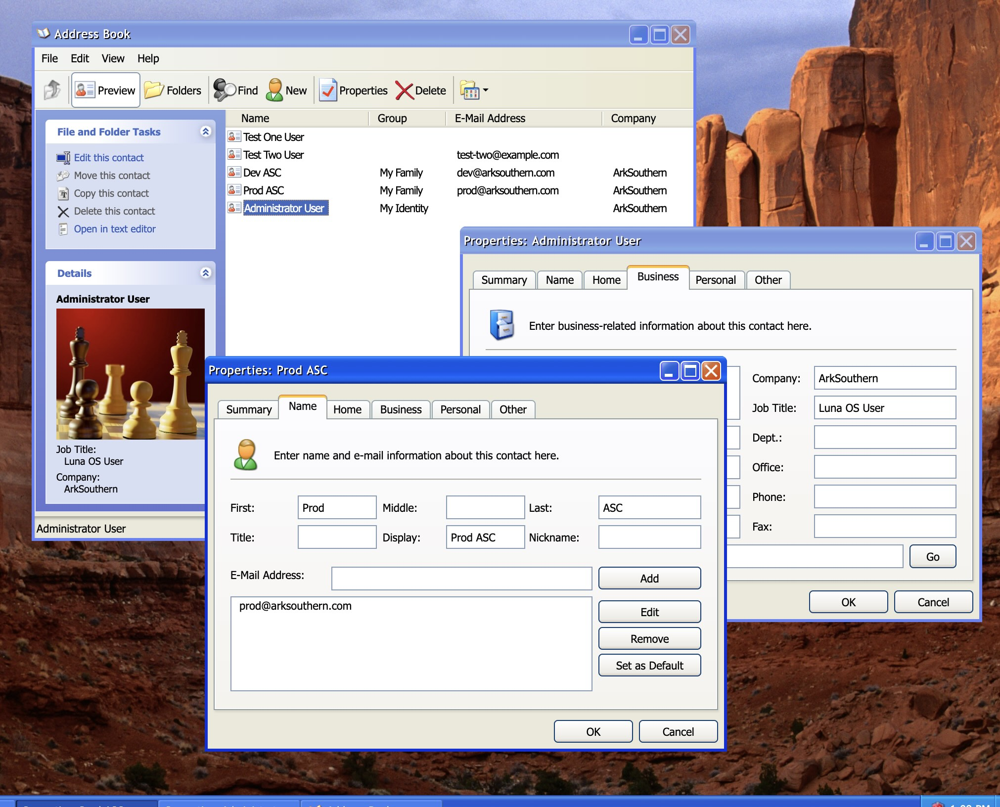
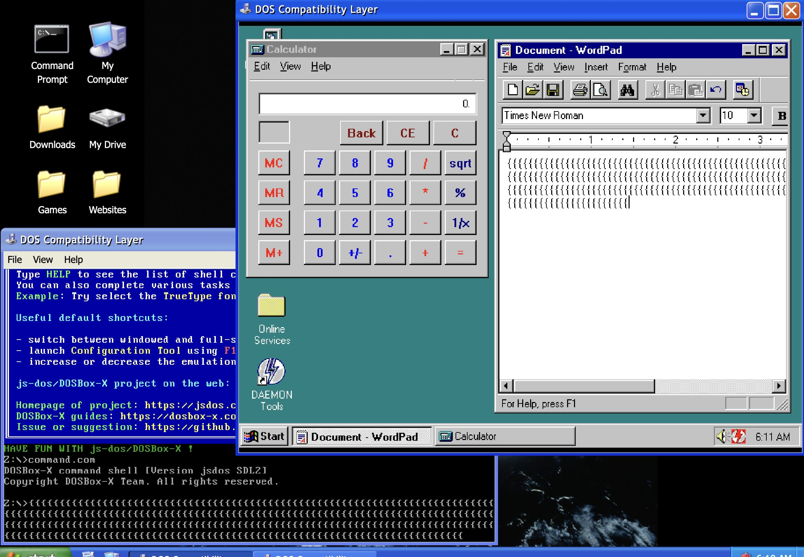

# Lib Ark Luna Starter
## Quick About
This is an SDK for developing Ark Luna programs. It has a stripped down version of Ark Luna, it includes the code for the notepad.exe app that ships in Ark Luna (the OS). The OS is not a traditional OS, but instead a Node JS console app that hosts a website on your localhost. When you visit localhost in your browser, you'll find a full featured Windows XP recreation. Inside is file explorer, a full shell, classic XP games, original notepad, but also an app store of sorts. Any GitHub repo that uses this very repo (arksouthern/lib-ark-luna-starter) is a program you can install from the app store.
  
Here are some of these programs we have been able to develop using the APIs &amp; UI components in this SDK:
  

|  |  |
| --- | --- |
  
## Get Started
### Install Dependencies
```sh
node install-all.js
```
### Run/Dev Your Program
#### Start the API server
```sh
cd backend
npm start
```
#### Start the HTTP server
```sh
cd frontend
npm start
```
### Open a web browser to the URL
Typically this URL is `http://localhost:3000/?http://localhost:3040`
If you've run both commands you can [click this link](http://localhost:3000/?http://localhost:3040).
## Creating your program
### Where is my program?
- Your app is located at `frontend/src/programs/v1`
- By default, you'll see `arksouthern.luna.note`
- Your program has its own `backend`, `frontend` folders
- The backend runs in Node JS on your machine
- The frontend runs in your web browser when the program opens
- The backend offers HTTP APIs or also WebSocket APIs to the frontend
### What UI components are part of your starter?
- Components are imported from `frontend/src/components/luna`
- XP-styled buttons, sliders, status bars, tabs, title bars, ribbon are available
- All components are built from shadcn/ui patterns
- Many icons, fonts, cursors are found in assets
### Can I bring my own NPM libraries?
- Yes, the frontend, backend each have a `package.json`
- Limit packages when possible, each app does not share Node modules
### What APIs can my backend offer?
- By exporting the `api` constant, you can offer type safe POST APIs
- By exporting the `any` constant, you can offer catch-all HTTP APIs
- By exporting the `ws` constant, you can offer type safe WebSocket APIs
### What built-in APIs can my frontend call?
- read files, open file in default program, query default programs
- create dialogs, modals, sub windows, multi-instance apps
- add keyboard shortcuts
- All available from `frontend/src/lib/luna.ts`
### Code examples you can run now:

#### A simple Run app dialog
[Visit the open source repo.](https://github.com/arksouthern/arksouthern.luna.run)
  

  
#### A contacts manager, file reader / writer
[Visit the open source repo.](https://github.com/arksouthern/arksouthern.luna.contacts)
  

  
#### DOS / retro Windows emulator
[Visit the open source repo.](https://github.com/arksouthern/arksouthern.luna.dos)


  
#### Full explorer file folder browser
[Visit the open source repo.](https://github.com/arksouthern/arksouthern.luna.explore)
  

  